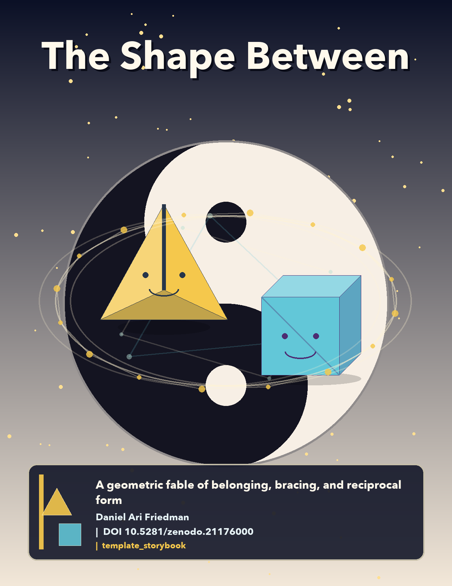

# The Shape Between

A standalone template for full-page illustrated storybooks. The bundled
fictional story follows Tessa, a tetrahedron raised by cubes, and Ciro,
a cube raised by tetrahedra. The storybook is assembled from procedurally
rendered pages and their text overlays.

- [Start a local build](docs/quickstart.md)
- [Read the documentation](docs/README.md)
- [Read or render the descriptive manuscript](docs/manuscript/README.md)
- [Read the published storybook snapshot](output/pdf/the-shape-between.pdf)

## Publication

<!-- PUBLISHING-STATUS:START (generated by infrastructure.publishing.status_report) -->
**The Shape Between: A Full-Page Illustrated Storybook Template** · v0.1.0 · MIT · Daniel Ari Friedman

Concept DOI: [10.5281/zenodo.21176000](https://doi.org/10.5281/zenodo.21176000) | Version DOI: [10.5281/zenodo.21176001](https://zenodo.org/records/21176001) | Repository: [docxology/template_storybook](https://github.com/docxology/template_storybook)

Publishing surface — 20 platforms, 8 published:

| Platform | Tier | Status | Reference | Credentials |
| --- | --- | --- | --- | --- |
| zenodo | first-class | ✅ published | [10.5281/zenodo.21176000](https://doi.org/10.5281/zenodo.21176000) | `ZENODO_API_TOKEN` |
| github | first-class | ✅ published | [https://github.com/docxology/template_storybook/releases/tag/v0.1.0](https://github.com/docxology/template_storybook/releases/tag/v0.1.0) | `GITHUB_TOKEN` |
| arxiv | first-class | ⚪ available | — | — |
| pypi | first-class | ✅ published | [https://test.pypi.org/project/template-storybook/0.1.0/](https://test.pypi.org/project/template-storybook/0.1.0/) | `PYPI_TOKEN`, `TESTPYPI_TOKEN` |
| ipfs_pinata | first-class | ✅ published | [https://gateway.pinata.cloud/ipfs/QmPcB1mTMZQb541ZsmwDwc6rQgSTLR4BGYefdTLsj1s5Qy](https://gateway.pinata.cloud/ipfs/QmPcB1mTMZQb541ZsmwDwc6rQgSTLR4BGYefdTLsj1s5Qy) | `PINATA_JWT` |
| ipfs_web3storage | first-class | ⚪ available | — | `WEB3_STORAGE_TOKEN` |
| software_heritage | first-class | ✅ published | [https://archive.softwareheritage.org/api/1/origin/save/git/url/https://github.com/docxology/template_storybook/](https://archive.softwareheritage.org/api/1/origin/save/git/url/https://github.com/docxology/template_storybook/) | — |
| github_pages | first-class | ⚪ available | [docxology/template_storybook](https://github.com/docxology/template_storybook) | `GITHUB_TOKEN` |
| cloudflare_pages | first-class | ⚪ available | — | `CLOUDFLARE_API_TOKEN` |
| netlify | first-class | ✅ published | [https://6a47fd2233010f4eb138cdcd--tranquil-kleicha-0c9203.netlify.app](https://6a47fd2233010f4eb138cdcd--tranquil-kleicha-0c9203.netlify.app) | `NETLIFY_AUTH_TOKEN` |
| huggingface_hub | first-class | ✅ published | [https://huggingface.co/datasets/ActiveInference/template_storybook](https://huggingface.co/datasets/ActiveInference/template_storybook) | `HUGGINGFACE_TOKEN`, `HF_TOKEN` |
| osf | first-class | ✅ published | [https://osf.io/xbajh/](https://osf.io/xbajh/) | `OSF_TOKEN` |
| amazon_kdp | documented | 🟡 planned | — | `AMAZON_KDP_EMAIL`, `AMAZON_KDP_PASSWORD` |
| google_play_books | documented | 🟡 planned | — | `GOOGLE_PLAY_BOOKS_SERVICE_ACCOUNT_JSON` |
| gumroad | documented | 🟡 planned | — | `GUMROAD_ACCESS_TOKEN` |
| leanpub | documented | 🟡 planned | — | `LEANPUB_API_KEY` |
| lulu | documented | 🟡 planned | — | `LULU_CLIENT_KEY`, `LULU_CLIENT_SECRET` |
| draft2digital | documented | 🟡 planned | — | `DRAFT2DIGITAL_API_TOKEN` |
| stripe | documented | 🟡 planned | — | `STRIPE_SECRET_KEY`, `STRIPE_PUBLISHABLE_KEY` |
| ingramspark | documented | 🟡 planned | — | `INGRAMSPARK_CLIENT_ID`, `INGRAMSPARK_CLIENT_SECRET` |

_Keywords: storybook, illustration, procedural graphics, reportlab, reproducible publishing._

_Status legend: ✅ published (durable identifier recorded in `config.yaml`) · 🔵 reserved (identifier reserved but not yet registered by final publication) · ⚪ available (adapter implemented and locally verifiable) · 🟡 planned. This block is generated — edit `docs/manuscript/config.yaml`, then regenerate with `uv run python -m infrastructure.publishing.status_report --project <path> --write`._
<!-- PUBLISHING-STATUS:END -->
