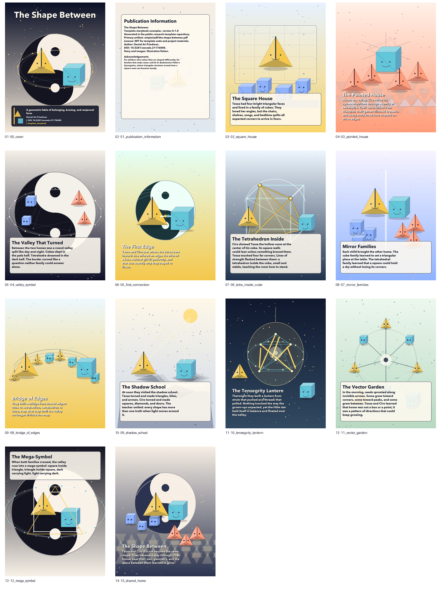

# Story and Graphics

Every page is rendered as a full-page PNG. Some pages place text directly over
the illustration with shadowed lettering; others use a translucent box when the
scene is visually dense. The YAML `overlay_box` value controls that choice per
page.

## Methods

The renderer uses simple geometric primitives: isometric cubes, shaded
tetrahedra, family clusters, a curved reciprocal symbol, deterministic star
fields, projected shadows, suspended tensegrity struts, and radial vector
gardens. The stability page borrows from the Synergetics intuition that
triangulated structure braces square space: a tetrahedron is drawn through four
alternating cube corners so the cube becomes steadier without ceasing to be a
cube [@fuller1975synergetics]. Later pages extend that grammar through
projection, push-pull balance, and directional growth. This gives forks a
readable baseline. Replacing the story does not require editing Python;
replacing the visual grammar does.

The generated contact sheet preserves the story order and labels the
thumbnail tiles by their originating page filenames. It supports
whole-book visual review before checking individual illustrations.

{#fig:storybook_contact_sheet width=75% fig-alt="A grid of labeled page thumbnails begins with the cover and proceeds through the contrasting shape families, bridge, shadow, lantern, garden, and shared home."}
